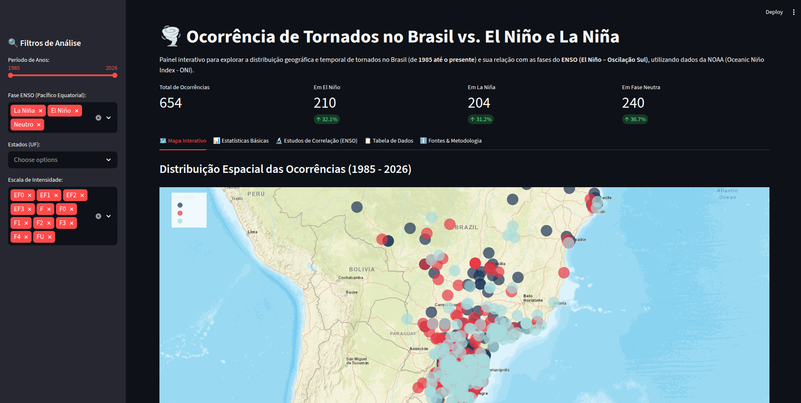

# 🌪️ Climatologia de Tornados no Brasil vs. El Niño e La Niña (1985 – Presente)

Projeto interativo para análise geoespacial e climatológica de tornados no Brasil correlacionados com as fases do fenômeno **ENSO (El Niño – Oscilação Sul)**.



---

## 📌 Por que esses dados são tão difíceis de encontrar?

1. **Ausência de Rede Radar Centralizada no Século XX:** Diferente dos Estados Unidos (com a rede NEXRAD e o Storm Prediction Center da NOAA), o Brasil não dispunha de cobertura contínua de radares meteorológicos doppler nas décadas de 80 e 90.
2. **Subnotificação e Confusão Terminológica:** A grande maioria dos episódios severos foi classificada por defesas civis municipais como *"vendaval"* ou *"temporal com chuvas intensas"*, pois não havia equipes de campo sistemáticas para diferenciar microexplosões (*downbursts*) de tornados.
3. **Limitação dos Dados Governamentais (S2iD):** O sistema oficial do Governo Federal (**S2iD**) só foi unificado e digitalizado a partir de 2012/2013, e registra apenas eventos que geraram decretos municipais de Situação de Emergência homologados pela União.
4. **Dispersão Acadêmica:** Os melhores registros históricos estão dispersos em pesquisas acadêmicas (ex.: tese do Dr. Daniel Henrique Candido na Unicamp, estudos de Lucí Hidalgo Nunes e Ernani de Lima Nascimento) e no projeto **PREVOTS / PRETS** (UFSM/INPE).

---

## 🚀 O que foi construído neste repositório?

1. **Dataset Unificado (`data/tornados_brasil_1985_presente.csv`):**
   - Mais de **660 ocorrências de tornados catalogadas no Brasil de 1985 até hoje**.
   - **Coordenadas geográficas (Latitude e Longitude)** obtidas por cruzamento com os 5.570 municípios do IBGE.
   - Cruzamento automático com o índice oficial **ONI (Oceanic Niño Index)** da NOAA mês a mês, classificando cada evento em **El Niño**, **La Niña** ou **Neutro**, com a intensidade da anomalia de temperatura (°C).

2. **Mapa Interativo em HTML (`mapa_tornados_brasil_enso.html`):**
   - Construído com Folium / Leaflet.
   - Abre diretamente em qualquer navegador com duplo clique (não requer servidor).
   - Possui controle de camadas (ligar/desligar El Niño, La Niña e Neutro), agrupamento inteligente (MarkerCluster) e popups detalhados com descrição, mortos e feridos.

3. **Dashboard Web Interativo (`app.py`):**
   - Construído com **Streamlit** e **Plotly**.
   - Filtros dinâmicos por ano (1985-2026), fase do ENSO, estados (UF) e intensidade Fujita (F0 a F4).
   - **Aba de Estudos de Correlação (`🔬 Estudos de Correlação`):**
     - Severidade e Teste Qui-Quadrado ($\chi^2 = 13.85, p = 0.0010$).
     - Análise de *Outbreaks* (surtos de múltiplos tornados no mesmo dia: 99 no El Niño vs 55 na La Niña).
     - Sazonalidade da Região Sul na Primavera (El Niño responde por 43,4% dos casos).
     - Decomposição secular: Subnotificação tecnológica (smartphones/GOES-16) vs. Tornados Severos estáveis.
   - Exportação direta de dados filtrados em CSV.

---

## 💻 Como Executar

### 1. Visualizar o Mapa HTML Diretamente
Basta abrir o arquivo no seu navegador favorito:
```bash
xdg-open mapa_tornados_brasil_enso.html
```

### 2. Executar o Dashboard Streamlit
```bash
streamlit run app.py
```

### 3. Atualizar ou Reconstruir os Dados
Para atualizar os índices da NOAA e recriar o dataset:
```bash
python3 build_dataset.py
python3 generate_map.py
```
